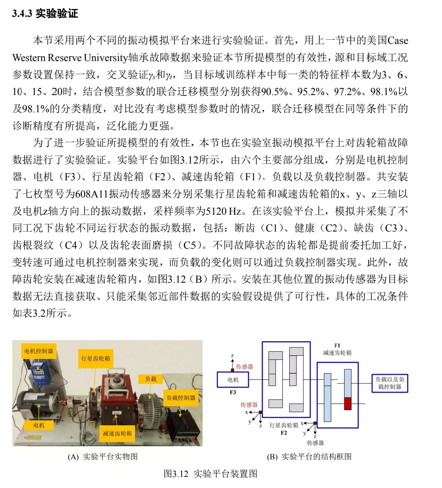

# SEU 采样率与实验台核查

核查日期：2026-11-04。区分原始说明、后续论文和厂商标准配置，暂不修改实验配置。

## 原始资料

[原仓库 README](https://github.com/cathysiyu/Mechanical-datasets) 明确数据来自 SEU 的 DDS，工况为 20-0、30-2。第 1 通道为电机振动，2—4 为行星箱 xyz，5 为电机扭矩，6—8 为平行轴箱 xyz。README 未给出采样率。

本地原论文 Shao 等《Highly Accurate Machine Fault Diagnosis Using Deep Transfer Learning》IV-C（期刊页 2453—2454）写明 DDS、20 Hz–0 V／30 Hz–2 V 和五类状态，未在该节给出采样率或齿数。

本地 CSV 表头是 Frequency Limit=2000、Spectral Lines=1600、Number of Blocks=1024、Total Data Rows=4194304。采样率字段未明确列出。实际文件有 1048560 行数据，Health_30_2 内部标题仍写 Health_20_0；表头与实际文件存在不一致，Frequency Limit 按原字段记录。

## 采样率证据

- [Sensors 2023, 23, 7573](https://www.mdpi.com/1424-8220/23/17/7573) 第 4.1 节明确将 SEU 信号最高频率 2000 与采样频率 5120 Hz 分开描述。
- [APHformerNET（2025）](https://doi.org/10.1049/cps2.70028) 第 3.1.2 节明确写 SEU、5120 Hz、八通道及两种工况。
- [原仓库 Issue 3](https://github.com/cathysiyu/Mechanical-datasets/issues/3) 有用户上传实验说明截图，写明 5120 Hz、七枚 608A11 振动传感器。截图缺少论文题名及完整出处，作为线索保留。
- Issue 中提到“2000”的 mankind-lgb 在 [Issue 4](https://github.com/cathysiyu/Mechanical-datasets/issues/4) 明确自述只是数据使用者。此次检查未找到仓库作者对采样率的明确回复。

结论：5120 Hz 是有多篇后续论文支持的工作值；原仓库与原论文的直接确认仍缺失。写作可表述为“参考后续使用 SEU 数据的文献，采样率按 5120 Hz 计”，注明来源。

## 实验台与参数

| 项目 | 查到的信息 | 来源层级 |
| --- | --- | --- |
| 平台 | DDS，电机及控制器、行星箱、减速／平行轴箱、制动器及控制器 | 原论文图 8；相关 DDS 实验论文 |
| 工况 | 20 Hz–0 V、30 Hz–2 V | 原论文 |
| 转速与负载换算 | 后续文献写 1200／1800 rpm，0／7.32 N·m | 后续 SEU 文献，非本地测量值 |
| 传感器 | 七个振动通道，加一个扭矩通道；608A11 型号出现在用户提供的截图 | 通道由仓库确认，型号待完整来源 |
| 厂商 DDS 行星箱 | 两级，27:1，第一级 4 个行星轮、第二级 3 个 | 厂商标准配置，实际采集装配待核对 |
| 太阳轮、行星轮、齿圈齿数 | 原仓库和原论文未列出 | 待原始机械图或装配资料 |
| 故障安装位置 | 原论文未明确；Issue 截图写故障齿轮安装于减速箱，图示位于 F1 | 新的相反线索，太阳轮假设需重新核实 |

转速、负载文献：[A Novel Multistep Wavelet Convolutional Transfer Diagnostic Framework…（2025）](https://www.mdpi.com/1424-8220/25/10/3141)，第 6.2.1 节。

厂商：[SpectraQuest DDS](https://spectraquest.com/drivetrain-diagnostics-simulator/)。标准机型参数用来解释设备结构，暂不代入这批数据的故障频率计算。

SEU 团队相关研究：[Shen 等，2020](https://doi.org/10.1186/s10033-020-00437-3)，第 7 节介绍 DDS、七路振动及可变转速负载实验，图 7 有内部结构。这篇使用更丰富的工况和重复采集，与 GitHub 两工况文件的对应关系待核实。

[Issue 6](https://github.com/cathysiyu/Mechanical-datasets/issues/6) 也有人询问型号和齿数，此次页面未见回复。

## 对窗长的意义

若按 5120 Hz 计算，1024／2048／4096／8192 点分别为 0.2／0.4／0.8／1.6 秒。若进一步按输入轴 1800 rpm 计算，则分别覆盖输入轴 6／12／24／48 转。这里只是采用上述文献参数的条件换算；太阳轮及其他轴的实际转数还取决于具体传动关系。

下一项需要补的是采集配置或原作者确认、实际齿轮装配参数，以及 Issue 截图的完整论文出处。当前太阳轮故障继续标作待核实假设。
