# 一维 CNN

我们继续用 SEU 的 `30_2` 数据做五分类，输入仍为行星箱 x、y、z 三轴振动。这条路线直接把窗口中的波形交给 CNN，由模型学习用于分类的特征，再与人工特征加随机森林的方案比较。

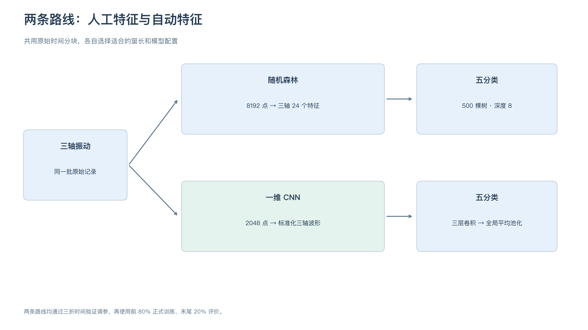

## 1. 准备输入

沿用随机森林的原始时间分块：每种状态有 1,048,560 个采样点，分成五个等长块，每块 209,712 点。前四块用于调参，最后一块用于保留评价。窗口在每块内单独切分、不重叠、不跨边界，尾部不足一窗的点舍弃。

CNN 的窗长单独选择。较短的窗口提供更多训练样本，较长的窗口包含更长时间的波形，我们比较 1024、2048、4096、8192 点，结合验证成绩决定。

| 窗长 | 时长 | 前 80% 窗口数 | 每折验证窗口数 |
| --- | --- | --- | --- |
| 1024 | 0.2 秒 | 4080 | 1020 |
| 2048 | 0.4 秒 | 2040 | 510 |
| 4096 | 0.8 秒 | 1020 | 255 |
| 8192 | 1.6 秒 | 500 | 125 |

时长按采用的 5120 Hz 采样率计算。每个输入窗口有三条同步序列，输入形状为“3 × 窗长”。

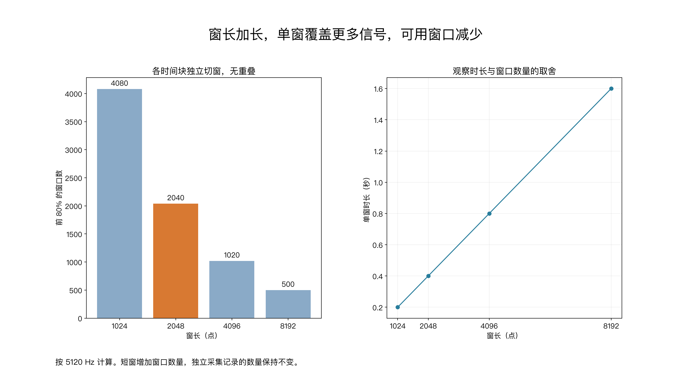

三轴分别标准化。每折只用训练块计算 x、y、z 的均值和标准差，训练窗口与验证窗口统一使用这组数。这样可以调整数值尺度，同时保留不同窗口之间的振幅差异。每个窗口不单独标准化。

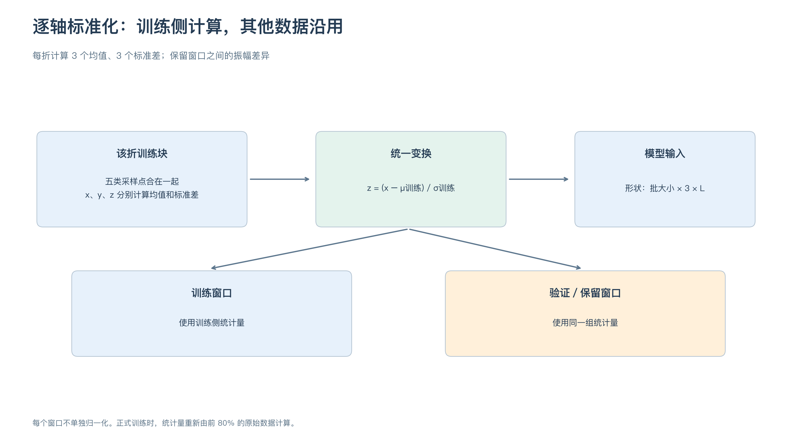

## 2. 建立一维 CNN

采用三层卷积，让模型逐步组合局部波形信息。前两层后加入最大池化，将序列长度减半；第三层后做全局平均池化，把每条响应序列变成一个特征，最后通过全连接层计算五类分数。

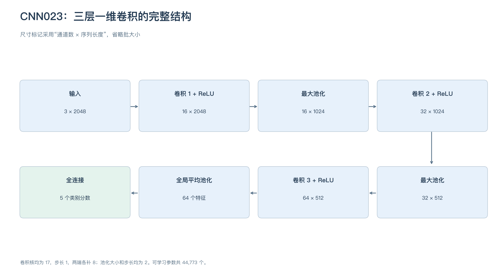

图中展示最终选中的配置：2048 点输入，三层通道数为 16→32→64，卷积核大小均为 17，卷积步长为 1，两端各补 8 点。两次最大池化的大小和步长均为 2，最终得到 64 个特征，再输出五类分数。网络共有 **44,773 个可学习参数**。

一个卷积核会对同一位置的所有输入通道加权求和，沿时间滑动后形成一条响应序列。不同卷积核学习不同的局部模式，后续层再组合这些响应。

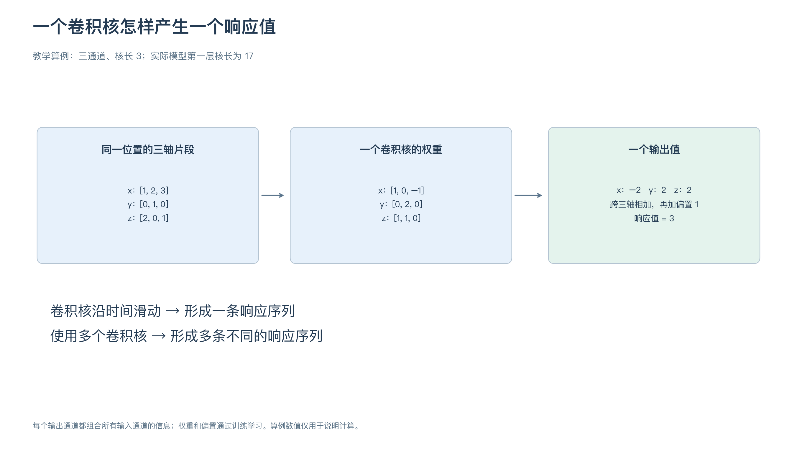

上图用三点片段说明计算，实际网络的卷积核长为 17。卷积核权重和偏置通过训练学习，层数、通道数和卷积核大小在训练前设定。

## 3. 联合选择窗长与超参数

为了让不同窗长都有合适的模型配置，我们同时比较窗长、卷积核大小、通道规模和学习率。

| 超参数 | 候选值 |
| --- | --- |
| 窗长 | 1024、2048、4096、8192 |
| 卷积核大小 | 5、9、17，同一模型三层取相同大小 |
| 三层通道数 | 8→16→32、16→32→64 |
| 学习率 | 0.001、0.0003 |

共 **48 套配置**。固定三层卷积、ReLU、两次最大池化和全局平均池化，采用 Adam、批大小 32、交叉熵损失，不加 Dropout 和权重衰减。

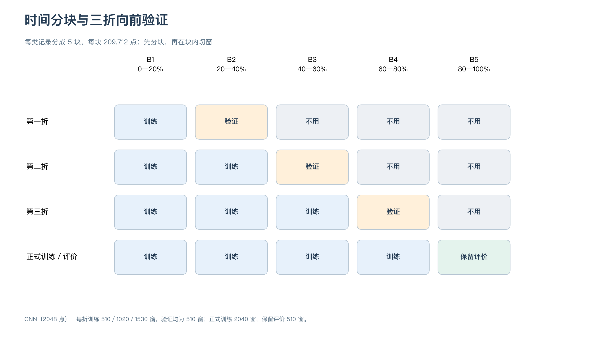

三折依次用第 1 块训练、第 2 块验证；前 2 块训练、第 3 块验证；前 3 块训练、第 4 块验证。每折重新初始化模型和优化器，重新计算训练侧标准化参数。

每次最多训练 100 轮。验证损失连续 15 轮没有降低就停止，恢复验证损失最低那一轮的模型，再计算宏 F1。验证损失用于选择模型轮次，三折宏 F1 均值用于比较配置。

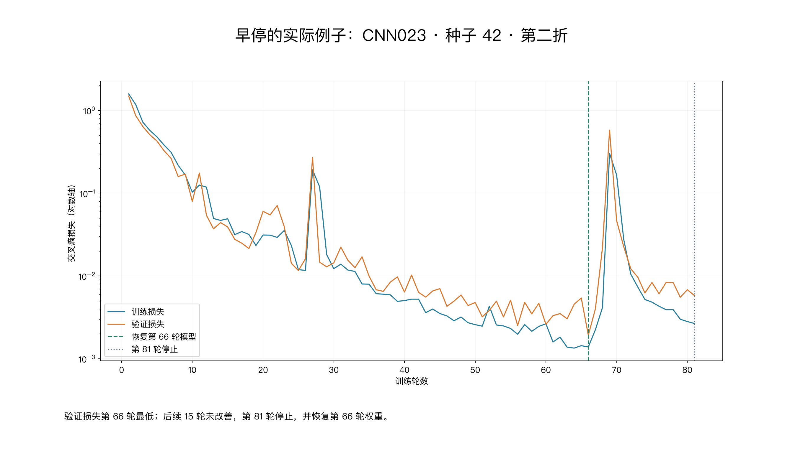

先固定种子 42，完成 48×3＝144 次训练。初筛有六组配置的三折成绩均为 1.0000，全部增加种子 7、2026 复跑，共增加 36 次，最终完成 **180 次训练**。每个复跑配置都有三种种子、三折共九个成绩。

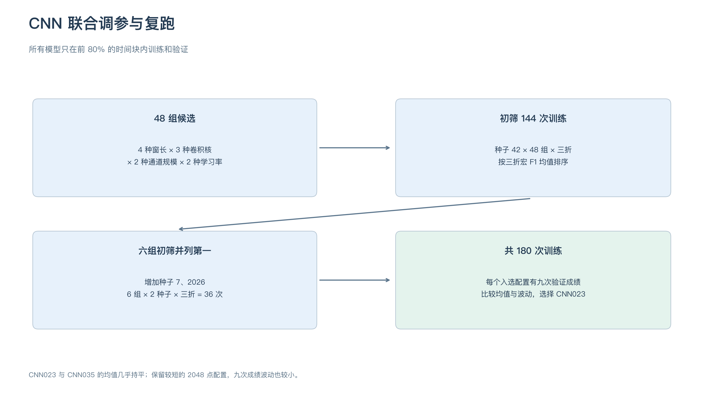

## 4. 调参结果与最终选择

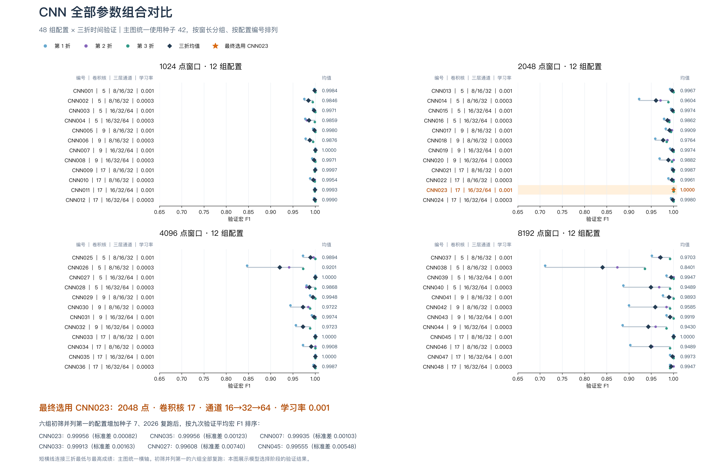

主图展示种子 42 的三折成绩，橙色突出选中的 CNN023。六组复跑结果如下，各组学习率均为 0.001。

| 配置 | 窗长 | 卷积核 | 通道数 | 九次平均宏 F1 | 标准差 |
| --- | --- | --- | --- | --- | --- |
| **CNN023** | **2048** | **17** | **16→32→64** | **0.99956426** | **0.00082** |
| CNN035 | 4096 | 17 | 16→32→64 | 0.99956423 | 0.00123 |
| CNN007 | 1024 | 9 | 16→32→64 | 0.99934586 | 0.00103 |
| CNN033 | 4096 | 17 | 8→16→32 | 0.99912846 | 0.00163 |
| CNN027 | 4096 | 5 | 16→32→64 | 0.99607549 | 0.00740 |
| CNN045 | 8192 | 17 | 8→16→32 | 0.99555413 | 0.00548 |

CNN023 与 CNN035 的平均成绩几乎持平。按平均宏 F1 排名，CNN023 仍排第一，其九次成绩波动较小，窗口观察时长也更短，因此继续采用 **2048 点、卷积核 17、通道 16→32→64、学习率 0.001**，保留 CNN035 作为相近方案。

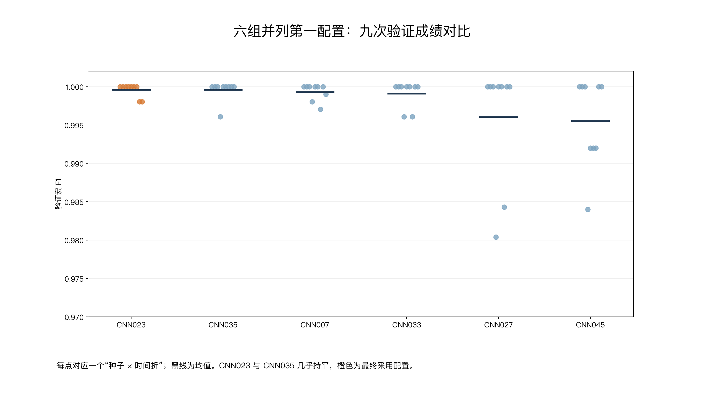

结果也说明 CNN 的窗长可以单独选择。在本次候选范围和训练预算下，2048 点已经取得很好的分类表现，增加窗长没有带来一致收益。180 次训练中有 156 次达到 100 轮上限，当前比较以这一预算为准。

## 5. 确定正式训练轮数

正式训练使用前 80% 的全部数据，轮数提前从交叉验证记录确定。CNN023 九次验证的最佳轮数为 91、66、36、77、62、61、100、34、52，取中位数 **62 轮**。

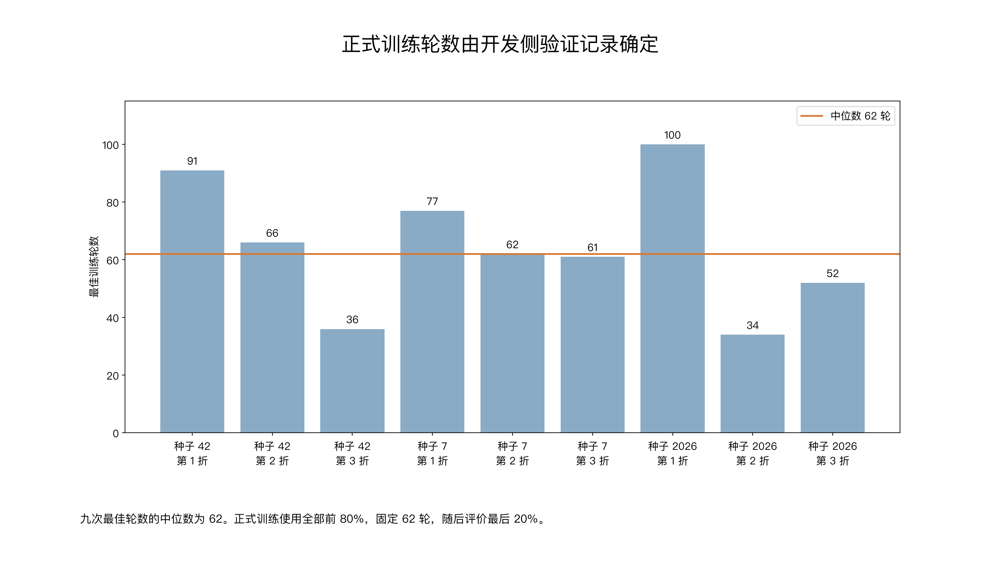

采用中位数，是为了减少个别较早或较晚最佳轮次的影响。这是本次正式训练的固定规则，最后 20% 的成绩不参与选轮数。

## 6. 正式训练与评价

固定种子 42，重新计算前 80% 数据的三轴均值、标准差，使用 **2040 个窗口训练 62 轮**。训练结束后保存模型，再读取最后 20%，按同样的标准化参数评价 **510 个窗口，每类 102 个**。

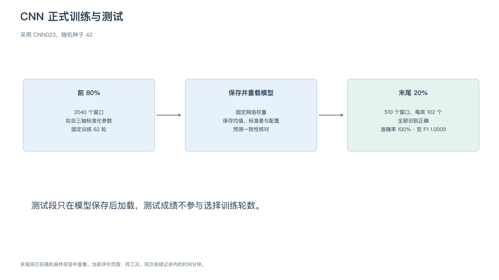

**准确率 100%，宏 F1 1.0000，正确 510／510 窗。** 健康、齿部、缺齿、齿根、齿面五种状态均识别正确。

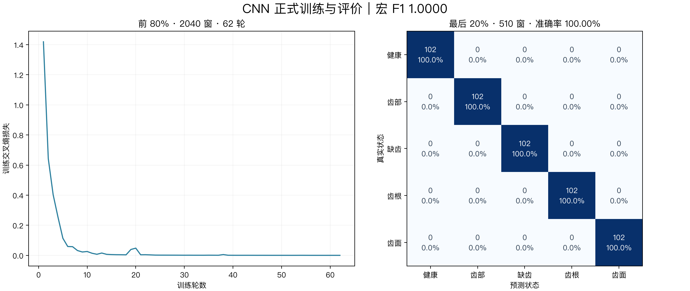

模型、标准化参数、训练损失、测试预测和环境信息均已保存。重新加载模型后预测一致，从混淆矩阵复算准确率和宏 F1，结果一致。

## 7. 与随机森林比较

| 项目 | 随机森林 | CNN |
| --- | --- | --- |
| 输入 | 三轴 24 个时域特征 | 标准化三轴原始波形 |
| 窗长 | 8192 点 | 2048 点 |
| 训练窗口 | 500 | 2040 |
| 评价窗口 | 125 | 510 |
| 准确率 | 99.20% | 100.00% |
| 宏 F1 | 0.9920 | 1.0000 |
| 错分 | 1 窗齿面判为缺齿 | 0 窗 |

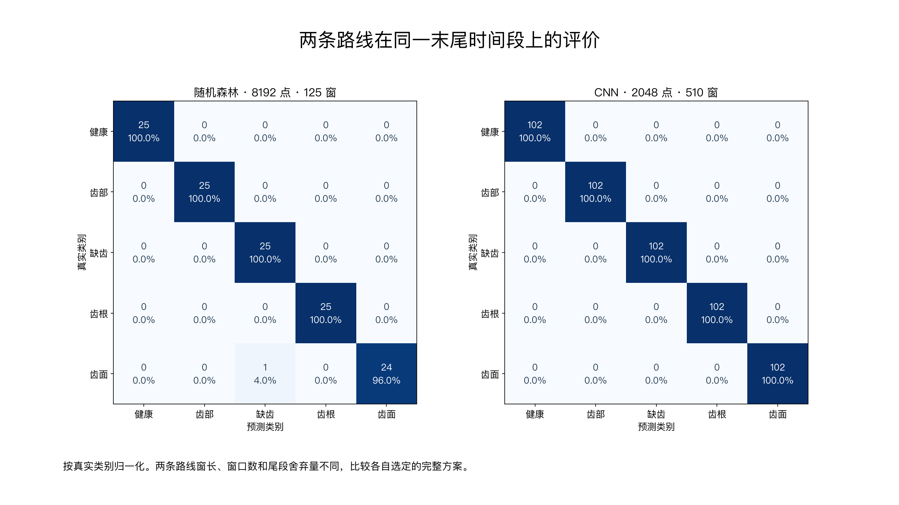

两条路线都在这批数据上取得了较好的分类效果。随机森林通过人工特征组织输入，CNN 直接从波形学习特征，并在当前评价段全部识别正确。

两者使用同一原始时间分块，窗长、窗口数量和末尾舍弃点数有所不同，表中比较各自选定的完整方案。最后 20% 在之前的随机森林实验中已查看，当前结果反映 **同工况、同次连续记录内** 的分类表现。后续可增加独立运行记录或跨工况评价，进一步观察模型的适用范围。

至此，CNN 路线已完成输入处理、模型配置、调参、正式训练和评价。指标与模型见 [正式评价资料](../outputs/SEU-CNN训练/final/results/)。
